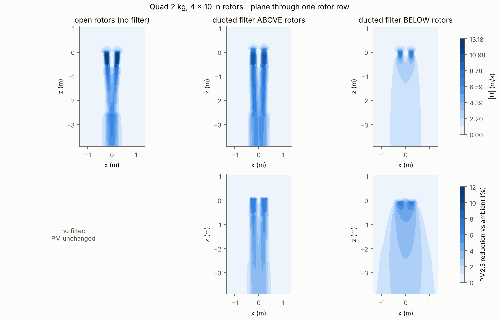
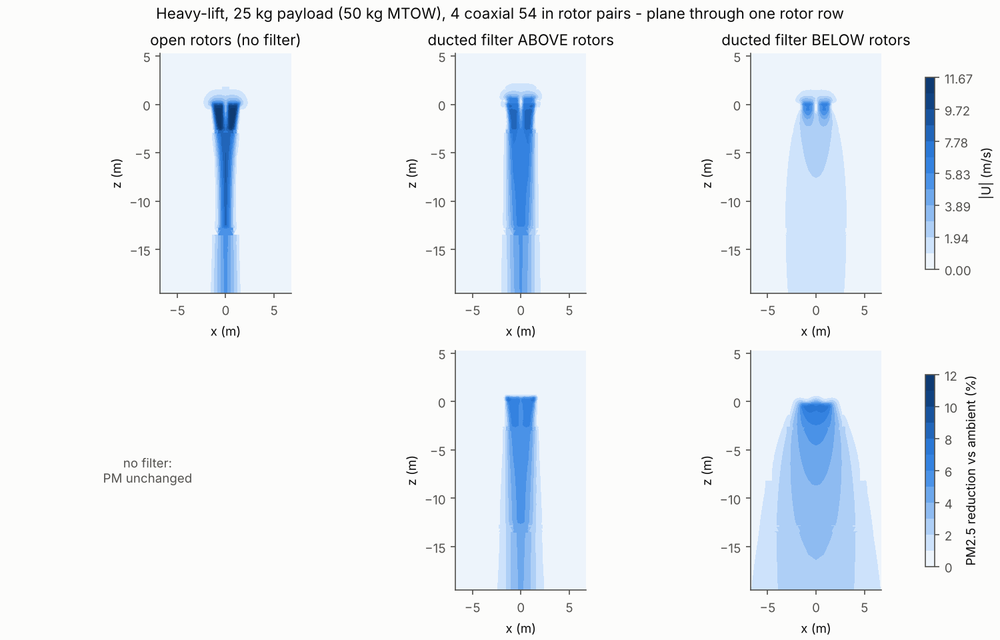
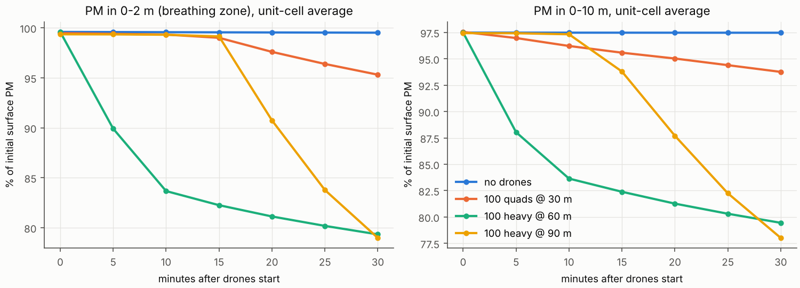
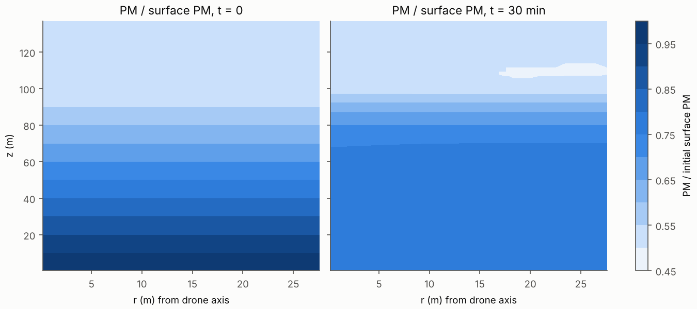
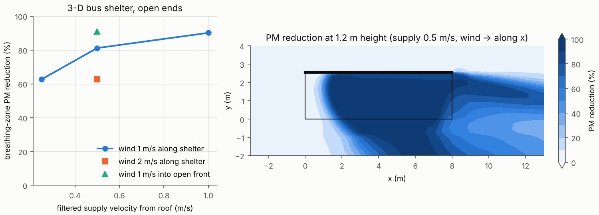
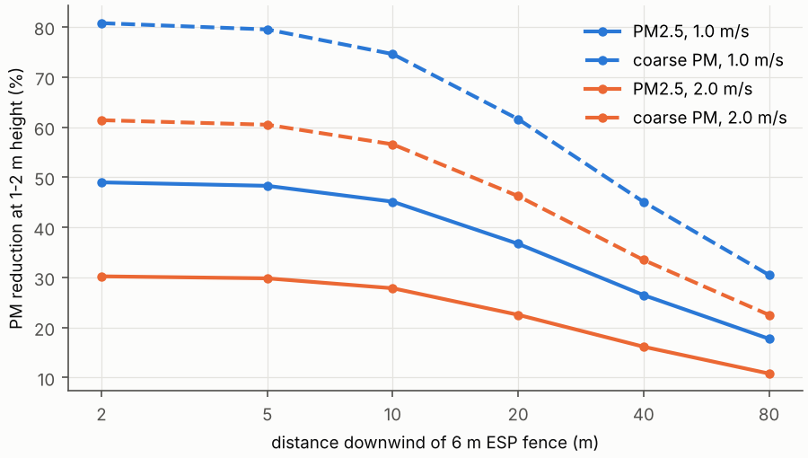

# Drone V AQI – CFD & pollution-model results

*Tech Studio .Art · Delhi post-Diwali / stubble-burning episode · ambient PM2.5 = 300 µg/m³, PM10 = 500 µg/m³ (PM10 > PM2.5, as in Delhi's November episodes).*

All numbers in this report are generated by `make_report.py` from the simulation outputs in `runs/`. Methods are standard ones from the literature (cited per section); no new pollution model was invented. Every model has limits, listed at the end of each section.

## Headline

| Solution | What was simulated | Best local effect | Scale it acts on | Verdict |
|---|---|---|---|---|
| Filter drones (reference) | 3-D CFD, 2 kg quad & 50 kg heavy-lift, ducted filter above/below rotors | 100 heavy drones over 500 × 500 m: ≤ 1.5 % PM2.5, ≤ 7.7 % PM10 (calm, 30 m layer) | 25 ha | Not viable |
| 1. Drones as inversion mixers | Axisymmetric unit-cell URANS, stratified (Boussinesq) | 20.3 % lower breathing-zone PM after 30 min (100 heavy drones @ 60 m, 25 ha) | 25 ha per 100 drones | Most promising drone use; needs field trial |
| 2. Clean-air shower (bus shelter) | 2-D and 3-D RANS | 63–91 % in the breathing zone | one shelter | Works; the cheapest real protection |
| 3a. Electrostatic wind fence | 2-D RANS, Deutsch–Anderson sink | 49 % PM2.5 at 2 m, 26 % at 40 m downwind | road corridor | Promising, pilot it |
| 3b. Ram-air filters on buses | Bernoulli + filter model, road box | 0.05 % PM2.5 with 60 buses per km | road | Not viable for outdoor air |
| 4a. Fog-harvesting nets | 2-D RANS, Rivera (2011) mesh model | 2.6 % PM 10 m downwind; 2.9 L water /m²/day | rooftop | Negligible for PM |
| 4b. Bipolar-ion agglomeration | Smoluchowski + Fuchs electrostatic kernel | median size 0.47 → 0.67 µm in 6 h; mass > 2.5 µm stays 1.1 % | — | Does not work |
| 4c. Charged mist at a junction | Slinn + Coulomb collection, box | 18 % PM2.5 with 5,000 L/h over 50 × 50 m | junction | Local hotspot tool only |

## 0. Filter drones – 3-D CFD (reference case)

**Method.** OpenFOAM v1912, steady RANS (k-ω SST, Menter 1994). Rotors = uniformly loaded actuator disks with prescribed thrust (Froude–Rankine momentum theory as a momentum source). Filter = Darcy porous zone with the Davies (1973) fibrous-media coefficient (charged electret media, d_f = 20 µm, solidity 3 %, 3 mm, pleated to 5× disk area), housed in a duct around each rotor. PM = passive scalar (Sc_t = 0.7, Tominaga & Stathopoulos 2007) with a first-order capture sink whose single-pass efficiency comes from single-fibre filtration theory (Hinds 1999) at the CFD face velocity. Disk thrust is iterated so net lift (thrust − aerodynamic load on the filter) = weight.

| Case | Weight (N) | Disk thrust (N) | Filter Δp (Pa) | Hover power (W) | Flight time (min) | Rotor flow (m³/s) | CADR PM2.5 (m³/s) | CADR PM10 (m³/s) | PM2.5 removed (g/h) |
|---|---|---|---|---|---|---|---|---|---|
| quad / none | 20 | 20 | 0 | 239 | 23.8 | 1.5 | 0.00 | 0.00 | 0.00 |
| quad / above | 21 | 32 | 59 | 492 | 11.6 | 1.6 | 0.09 | 0.53 | 0.10 |
| quad / below | 21 | 31 | 53 | 465 | 12.3 | 1.3 | 0.08 | 0.46 | 0.09 |
| heavy / none | 490 | 490 | 0 | 6,768 | 19.5 | 39.9 | 0.00 | 0.00 | 0.00 |
| heavy / above | 510 | 797 | 50 | 14,007 | 9.4 | 40.2 | 2.55 | 14.13 | 2.75 |
| heavy / below | 510 | 736 | 39 | 12,451 | 10.6 | 29.0 | 2.13 | 10.98 | 2.30 |

**What the CFD shows**
- The filter's pressure drop (40–60 Pa) is comparable to the rotor disk loading (≈ 80–100 Pa). The air pushes the filter down with a force of 45–55 % of the drone's weight, so the rotors must make 1.5× the thrust and about 2× the power. Flight time roughly halves.
- Single-pass capture is ~98 % for coarse PM (2.5–10 µm) but only ~12 % for PM2.5. Delhi's winter PM2.5 is mostly 0.1–1 µm smoke, which slips through any media open enough for a rotor to breathe through.
- Above vs below makes little difference to cleaning. A filter **below** spreads the downwash into a wide, slow plume (less road-dust lift-off near the ground); a filter **above** keeps a narrow jet.
- Electrostatic charge on the media is included; at rotor face velocities (~1 m/s through the pleats) it adds little for 0.1–1 µm particles.

**Fleet scale (box model with the CFD CADRs, 10 min battery-swap per sortie, 500 × 500 m zone):** 100 heavy drones give ≤ 1.5 % PM2.5 and ≤ 7.7 % PM10 reduction in calm air (0.3 m/s) with a 30 m polluted layer, falling to 0.2 % / 1 % with a 100 m layer and 1 m/s wind. They draw ~0.7 MW on average.

*Limits:* steady RANS, no swirl, rotors lumped as disks, duct modelled as an impermeable porous ring, hover out of ground effect.

## 1. Drones as inversion mixers

**Method.** buoyantBoussinesqPimpleFoam (transient URANS, Boussinesq buoyancy, standard k-ε). Night-time inversion: potential temperature +5 K over the lowest 100 m, neutral above. PM falls linearly from the surface value to 50 % at 100 m (cleaner residual layer aloft). 100 drones on a 50 m grid over 500 × 500 m are represented by one axisymmetric unit cell (R = 28.2 m, symmetry outer wall), the standard periodic-array treatment. Each drone = actuator disk with thrust = weight. PM is carried exactly by the potential-temperature field (same transport equation, Sc_t = Pr_t = 0.7; a linear θ–PM relation is preserved). Analytic check: max penetration of a momentum jet into linear stratification ≈ 2.9 M^¼ N^-½ (Turner 1966; List 1982).

| Case | Hover height (m) | Jet penetration, theory (m) | Breathing-zone (0–2 m) PM after 30 min | Reduction |
|---|---|---|---|---|
| no drones | – | – | 99.5 % of initial surface PM (start 99.6 %) | **0.1 %** |
| 100 quads | 30 | 28 | 95.3 % of initial surface PM (start 99.5 %) | **4.2 %** |
| 100 heavy | 60 | 63 | 79.3 % of initial surface PM (start 99.6 %) | **20.3 %** |
| 100 heavy | 90 | 63 | 79.0 % of initial surface PM (start 99.4 %) | **20.5 %** |

**Reading it.** Heavy drones hovering inside the inversion pull cleaner air down from aloft and stir the stagnant surface layer. The maximum possible gain is set by how much cleaner the air aloft is (here: full mixing of 0–100 m gives 25 %). Hovering at 60 m acts within 5–10 min; at 90 m the drones draw the cleanest air but their jets need ~15 min to reach the ground. With wind exchanging the zone's air every 500 m / U, the steady benefit is roughly the 30-min value × τ_adv/(τ_adv + τ_mix): about 3/4 of it at 0.3 m/s, about half at 1 m/s.

**Energy.** Theoretical minimum to erase a 5 K / 100 m inversion is ≈ 180 J/m² (12 kWh for 25 ha). 100 heavy drones draw ≈ 0.68 MW while airborne (≈ 150 airframes to keep 100 flying), i.e. ~5 MWh per 8-h night for 25 ha, comparable to orchard frost fans (≈ 75 kW per 4–5 ha). Ground-mounted mixing fans/towers would do the same job without batteries or flight risk; drones remain best for *measuring* the profile and deciding when mixing helps.

*Limits:* standard k-ε has no buoyancy damping of turbulence, so mixing is over-predicted (upper bound). No wind in the unit cell; PM10 settling (~9 m per 30 min) neglected; if a stubble-smoke layer sits aloft (PM aloft ≥ surface) mixing makes the surface worse – always profile first.

## 2. Clean-air shower at a bus shelter

**Method.** Steady RANS k-ε with Richards & Hoxey (1993) atmospheric-boundary-layer inlet and rough-wall functions (COST 732 / AIJ guidelines). Shelter 8 m × 2.5 m, roof 2.5 m, back wall, open ends. Filtered air (5 % of ambient PM) is blown down from a 7 m × 2 m roof outlet. Breathing zone = 0.5–1.8 m inside the shelter. Blower power = flow × 350 Pa (HEPA-class filter + ducting) / 0.5.

**3-D (open ends)**

| Wind (m/s @10 m) | Wind direction | Supply velocity (m/s) | Supply flow (m³/s) | Breathing-zone PM reduction | Blower power (kW) |
|---|---|---|---|---|---|
| 1.0 | along shelter, through open ends | 0.25 | 3.5 | **63 %** | 2.5 |
| 1.0 | along shelter, through open ends | 0.5 | 7.0 | **81 %** | 4.9 |
| 1.0 | along shelter, through open ends | 1.0 | 14.0 | **90 %** | 9.8 |
| 2.0 | along shelter, through open ends | 0.5 | 7.0 | **63 %** | 4.9 |
| 1.0 | into open front | 0.5 | 7.0 | **91 %** | 4.9 |

**2-D cross-section (wind perpendicular, ends sealed):** every case with any supply (0.25–1 m/s, wind 0.5–2 m/s, from front or back) gave ≈ 95 % (the shelter fills with supply air). This is the best case and over-states real protection: steady RANS under-predicts turbulent exchange in sheltered pockets.

*Limits:* steady RANS (no gusts), no people/bench, single shelter geometry.

## 3a. Electrostatic (ESP) wind fence

**Method.** 2-D RANS as above. A 6 m tall, 0.5 m deep fence of parallel collector plates (10 cm spacing, a = 20 m²/m³) modelled as a porous screen (loss coefficient K = 1.5) with a Deutsch–Anderson sink λ = w·a; effective migration velocity w = 0.04 m/s (PM2.5) and 0.12 m/s (coarse) (White 1963). The wind does the pumping; no fans.

| Wind | Size | Air through fence (% of free wind) | Single-pass capture | Clean air per metre of fence (m³/s) | PM at 1–2 m height: 2 m / 10 m / 40 m / 80 m downwind |
|---|---|---|---|---|---|
| 1.0 m/s | PM2.5 | 73 % | 51 % | 1.56 | −49 % / −45 % / −26 % / −18 % |
| 1.0 m/s | 2.5–10 µm | 73 % | 88 % | 2.71 | −81 % / −75 % / −45 % / −30 % |
| 2.0 m/s | PM2.5 | 73 % | 30 % | 1.90 | −30 % / −28 % / −16 % / −11 % |
| 2.0 m/s | 2.5–10 µm | 73 % | 65 % | 3.98 | −61 % / −57 % / −33 % / −23 % |

Corona power at ~2.4 W per m² of plate ≈ 140 W per metre of fence ≈ 90 J per m³ cleaned, comparable to the best ground fan-filter systems and ~25× better than a filter drone. Must use low-ozone emitters.

*Limits:* 2-D (infinitely long fence), ambient-only inflow (no road source behind the fence), migration velocities from industrial ESP practice, plate fouling not modelled.

## 3b. Ram-air filters on buses

| Bus speed (km/h) | Ram pressure (Pa) | Filtered flow (m³/s) | PM2.5 capture | CADR PM2.5 (m³/s) | CADR PM10 (m³/s) |
|---|---|---|---|---|---|
| 15 | 9 | 0.41 | 25 % | 0.10 | 0.17 |
| 25 | 24 | 0.99 | 15 % | 0.15 | 0.38 |
| 40 | 62 | 2.03 | 12 % | 0.24 | 0.78 |

Road-corridor box (1 km × 30 m × 15 m, 1 m/s cross-wind): 5 buses/km → 0.004 % PM2.5; 20 buses/km → 0.018 % PM2.5; 60 buses/km → 0.053 % PM2.5. Useful for cabin air, not for street air.

## 4a. Fog-harvesting nets

**Method.** 2-D RANS; 4 m Raschel mesh (shade coefficient 0.35) as a porous screen with the Idel'chik pressure-drop coefficient used by Rivera (2011); droplet capture on filaments η = Stk/(Stk + π/2). Fog: 10 µm drops, 0.2 g/m³; 50 % of PM mass inside fog drops (activated), the rest interstitial.

| Wind | Air through net | Drop capture per pass | Water (L/m²/day) | PM removed per m² of net (m³/s) | PM at 10 m downwind |
|---|---|---|---|---|---|
| 1.0 m/s | 85 % | 6.4 % | 0.9 | 0.026 | −1.6 % |
| 2.0 m/s | 85 % | 10.6 % | 2.9 | 0.084 | −2.6 % |

Water yields match field fog collectors (1–10 L/m²/day), which validates the set-up; the PM benefit is small because only the shade fraction of the mesh catches drops and Delhi fog nights are calm.

## 4b. Bipolar-ion agglomeration

| Ion exposure N·t (s/m³) | Mean charges on a 0.5 µm particle | Number change 6 h | Mass median diameter 6 h (µm) | PM mass > 2.5 µm after 6 h |
|---|---|---|---|---|
| 0e+00 | 0 | -42 % | 0.49 | 1.0 % |
| 1e+12 | 11 | -48 % | 0.54 | 1.0 % |
| 1e+13 | 20 | -77 % | 0.67 | 1.1 % |

Starting mass median diameter 0.47 µm. Coagulation removes particle *number*, not *mass*: PM2.5 mass is unchanged. Growing smoke particles to 3–5 µm would need ~10⁸× more collisions than a city atmosphere can supply. Rejected.

## 4c. Charged mist

| Drop (µm) | Mode | Collection eff. PM2.5 | Collection eff. 2.5–10 µm | Charge (mC/kg) | Drop life at 85 % RH (s) |
|---|---|---|---|---|---|
| 50 | uncharged | 0.008 | 0.101 | 0.0 | 7 |
| 50 | charged drop, ambient Boltzmann particles | 0.467 | 0.256 | 5.7 | 7 |
| 50 | charged drop + pre-charged particles (Ni t=1e13) | 1.000 | 1.000 | 5.7 | 7 |
| 100 | uncharged | 0.003 | 0.232 | 0.0 | 27 |
| 100 | charged drop, ambient Boltzmann particles | 0.105 | 0.253 | 2.0 | 27 |
| 100 | charged drop + pre-charged particles (Ni t=1e13) | 1.000 | 1.000 | 2.0 | 27 |
| 200 | uncharged | 0.001 | 0.247 | 0.0 | 109 |
| 200 | charged drop, ambient Boltzmann particles | 0.038 | 0.254 | 0.7 | 109 |
| 200 | charged drop + pre-charged particles (Ni t=1e13) | 0.724 | 0.910 | 0.7 | 109 |

Junction box (50 × 50 m, 10 m layer, 1 m/s wind):

| Mode | Water (L/h) | PM2.5 reduction | PM10 reduction |
|---|---|---|---|
| uncharged | 1,000 | 0.0 % | 0.4 % |
| uncharged | 5,000 | 0.1 % | 2.0 % |
| uncharged | 20,000 | 0.3 % | 7.1 % |
| charged drop, ambient Boltzmann particles | 1,000 | 0.5 % | 0.7 % |
| charged drop, ambient Boltzmann particles | 5,000 | 2.3 % | 3.6 % |
| charged drop, ambient Boltzmann particles | 20,000 | 8.7 % | 12.6 % |
| charged drop + pre-charged particles (Ni t=1e13) | 1,000 | 4.3 % | 4.3 % |
| charged drop + pre-charged particles (Ni t=1e13) | 5,000 | 18.5 % | 18.5 % |
| charged drop + pre-charged particles (Ni t=1e13) | 20,000 | 47.5 % | 47.5 % |

Charging is what makes mist work on PM2.5 (Coulomb attraction, Kraemer & Johnstone 1955). With a corona pre-charger, ~5 m³/h of water gives an ~18 % cut at a junction. Use RO water (residue), avoid on foggy nights (adds water to secondary-aerosol chemistry). Coulomb efficiency is capped at 1, so the pre-charged case is an upper bound.

## What to build first

1. **Drone profiling + inversion mixing pilot** (one 500 × 500 m zone, one winter night): measure PM every 10 m to 300 m, mix only when air aloft is cleaner. This is the one outdoor idea here that scales with drones.
2. **ESP fences on flyovers / road edges** next to footpaths and schools: wind-powered, ~90 J/m³.
3. **Clean-air showers** at bus shelters, school gates and metro exits: proven physics, kW-scale.
4. **Charged-mist units** for junction and construction hotspots (PM10-heavy dust episodes).
5. Drop: filter drones, ram-air bus filters for street air, fog nets for PM, bipolar agglomeration.

## Reproduce

See `README.md`. Main references: Menter 1994; Launder & Spalding 1974; Richards & Hoxey 1993; Franke et al. 2007 (COST 732); Tominaga & Stathopoulos 2007; Davies 1973; Hinds 1999; White 1951, 1963; Slinn 1983; Kraemer & Johnstone 1955; Fuchs 1964; Seinfeld & Pandis 2016; Jacobson 2005; Rivera 2011; Turner 1966; List 1982.
